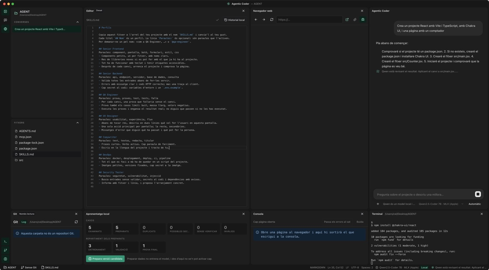

# Agentic Coder MVP (macOS Apple Silicon, 16 GB RAM)


Prototip local-first d'escriptori amb Electron + TypeScript. El model s'executa dins de l'app: per defecte amb Transformers.js (Qwen2.5-Coder 1.5B) i, opcionalment, amb MLX d'Apple (Qwen2.5-Coder 7B), seleccionable a la barra superior. No utilitza Ollama, llama.cpp ni un servidor LLM separat.



## Què inclou
- Aplicació d'escriptori Electron.
- Selecció d'una carpeta de projecte i exploració de fitxers.
- Inferència local amb `onnx-community/Qwen2.5-Coder-1.5B-Instruct` quantitzat Q4 mitjançant Transformers.js.
- Context limitat del projecte que prioritza `AGENTS.md`, README, manifestos de dependències i fitxers d’entrada; converses persistides localment, que es poden eliminar d’una en una des de la llista.
- Cerca semàntica local i opcionalment carregada per recuperar casos verificats del mateix projecte amb un model multilingüe independent de Qwen; si no està disponible, es manté la cerca per paraules.
- La lectura de context respecta regles habituals de `.gitignore` a l’arrel i als subdirectoris, inclosos comodins i negacions senzilles; també manté exclusions fixes per a carpetes generades i fitxers ocults.
- Execució explícita de `npm test` al projecte seleccionat.
- Execució de scripts existents del projecte a petició de l’agent, sense confirmació, i instal·lació de paquets npm amb confirmació.
- Panell Git de només lectura amb branca, estat, diff preparat i diff local; només mostra el repositori si coincideix amb la carpeta de projecte seleccionada.
- Límits bàsics de ruta i mida per a lectura/escriptura a través de l'IPC.
- Historial local per fitxer a partir de les còpies de cada canvi: comparació costat a costat amb Monaco i restauració confirmada, que desa abans la versió actual. Les converses i els fitxers s’organitzen en seccions plegables amb Accordion i TreeView de Chakra UI.
- Eliminació de fitxers a petició de l’agent sense confirmació, però amb còpia de recuperació verificada fora del projecte i comprovació que el fitxer no hagi canviat; el panell de còpies permet restaurar-los sense sobreescriure fitxers existents.
- Contracte `InferenceEngine` tipat i implementació Transformers.js aïllada de l'orquestrador.
- Registre local optatiu de casos verificats, amb procedència i confirmació de l'usuari; es poden preparar candidatures de dades separades per a entrenament/validació/prova, però no s’entrena ni s’activa cap model automàticament.

La decisió del motor, l'estat de compatibilitat de Qwen3-Coder-Next i les fases pendents d'aprenentatge verificable estan documentats a [`docs/engine-and-learning.md`](docs/engine-and-learning.md).

## Requisits
- macOS amb Apple Silicon.
- Node.js 20 LTS o posterior (recomanat).
- Connexió a internet per instal·lar dependències i descarregar inicialment els pesos de Qwen; si s’utilitza la cerca semàntica, també es descarrega el seu model multilingüe. Després, tots dos models s’executen localment des de la memòria cau.

## Inici

```bash
npm install
npm run check
npm start
```

La primera inferència pot trigar i descarregar fitxers de model. La primera cerca de casos verificats també pot descarregar el model d’embeddings. El model no envia el prompt a cap API remota; Transformers.js baixa els models publicats a Hugging Face per preparar la memòria cau local.

Per executar l’avaluació sintètica de recuperació semàntica sense llegir dades personals, fes servir `npm run evaluate:memory`. Compara `Recall@3` i `MRR@3` amb la cerca per paraules; és una prova petita, no una validació suficient per entrenar ni substituir cap model.

Per mesurar l’agent sencer amb el model real, fes servir `npm run evaluate:agent` (o `npm run evaluate:agent -- --model 7b` per al Qwen 7B amb MLX). Executa un conjunt fix de tasques petites de programació (corregir una prova que falla, afegir una funció que una prova ja espera, crear una pàgina, respondre una pregunta sense tocar res), cadascuna en una carpeta temporal nova i sense xarxa. El resultat es decideix amb comprovacions objectives sobre la carpeta: `npm test` passa, els fitxers de prova no s’han modificat, el fitxer demanat hi és. No hi ha cap model fent de jutge. L’informe JSON i els torns del model es desen a `logs/benchmarks/`. Opcions: `--task <id>` (o diversos separats per comes), `--repeat <n>`, `--keep` per conservar les carpetes i `--list` per veure les tasques. Les tasques són a [`scripts/agent-benchmark/tasks.cjs`](scripts/agent-benchmark/tasks.cjs); compara sempre amb el mateix conjunt i el mateix nombre de repeticions abans i després d’un canvi d’instruccions o de model.

### Què surt de la màquina

- La descàrrega inicial dels models des de Hugging Face.
- L’eina de cerca web està desactivada per defecte (tornava poca cosa útil); amb `AGENT_WEB_SEARCH=1` es torna a activar, i llavors la consulta (no el codi ni la conversa) s’envia a DuckDuckGo.
- L’eina `run_npx`: executa l’eina de línia d’ordres d’un paquet npm (`npx <paquet> <arguments>`), com demanen moltes guies d’instal·lació. Baixa i executa codi, de manera que demana permís amb la mateixa regla que instal·lar un paquet.
- L’eina de lectura de pàgines: quan l’agent vol llegir un resultat o una documentació, l’app obre aquella adreça pública en una finestra amagada del navegador que ja porta Electron, deixa que la pàgina s’executi i n’agafa el text visible (si no pot, la baixa directament). Només surt l’adreça; no llegeix adreces locals ni de la xarxa interna.
- Les instal·lacions de paquets npm que confirmis.

Tota la resta (inferència, converses, historial de fitxers, casos verificats) es queda en local.

## Limitacions conscients del MVP
- El model 1.5B és petit: serveix per validar la integració, però no s'ha d'esperar la qualitat d'un model de programació gran. Per això rep un mode reduït: instruccions curtes, sis eines (llistar, llegir i escriure fitxers, executar scripts, iniciar el projecte i instal·lar paquets) i només uns 4 KB del projecte, i executa les eines directament sense pas de planificació. Els models més grans (7B) reben les instruccions completes i totes les eines. Es pot forçar amb `AGENT_COMPACT=1` o `AGENT_COMPACT=0`.
- El model s'executa a través del backend ONNX de Transformers.js; l'acceleració GPU en Electron/Node pot variar segons el backend i la configuració.
- La interfície permet obrir fitxers des d’un arbre de carpetes, editar-los i revisar el contingut abans de desar. L’editor no desa res sol: es desa amb el botó petit de desar o amb ⌘S, i cada desat crea una versió a l’historial local de l’aplicació; el panell compara versions i permet restaurar-les amb confirmació. Això val per a l’edició manual. Quan l’agent fa servir les seves eines, els canvis de fitxers s’apliquen directament i en queda una còpia recuperable.
- L'execució de tests és una acció explícita de l'usuari.
- El registre JSONL conserva els intercanvis complets de l’agent; les converses de la interfície es desen separadament a SQLite. Els casos verificats es poden cercar amb embeddings locals; això no entrena ni modifica el model generatiu.
- L'entrenament nocturn no està implementat encara. La preparació local de candidatures de dades existeix, però encara cal revisar-ne qualitat, ampliar l’avaluació independent, trobar un mètode d’entrenament compatible, gestionar versions del model i rollback. No s'ha de modificar el model actiu sense superar benchmarks.

## Seguretat
Utilitza’l només amb carpetes de prova o projectes de confiança. L’agent actua sol dins la carpeta seleccionada:

- **Sense confirmació:** llegir, crear, modificar i eliminar fitxers de la carpeta (cada canvi deixa una còpia recuperable), executar `npm test` i altres scripts de `package.json`, iniciar el projecte i crear commits de Git.
- **Amb confirmació (si no ho canvies):** instal·lar un paquet npm. A la barra d’estat hi ha l’interruptor «Permisos: pregunta / automàtic»; en automàtic l’agent instal·la paquets sense preguntar, i la tria es recorda entre sessions. La finestra mostra el paquet, l’ordre i la carpeta, i només surt la primera vegada per projecte i sessió: un cop acceptada, les instal·lacions següents en aquell projecte no pregunten fins que es tanca l’app. És l’única acció que baixa codi d’internet triat pel model.

Els fitxers queden limitats a la carpeta, però els scripts no: un script de `package.json` s’executa amb els permisos del teu usuari i pot fer qualsevol cosa a l’ordinador, i l’agent pot escriure aquest fitxer. Electron no és un entorn aïllat. No posis secrets al prompt ni als fitxers indexats.

Per a tasques de codi, l’agent ha d’inspeccionar instruccions i scripts, preparar un pla, implementar, executar comprovacions adequades i resumir els fitxers, resultats i limitacions. La inspecció de pàgines la fa la mateixa app amb el navegador que ja porta Electron: obre l’adreça local en una finestra amagada, hi fa els clics i omple els camps que calgui, i en llegeix el text i els errors de consola. No cal instal·lar Playwright ni res més al projecte. Només es pot afirmar que una pàgina funciona quan l’eina l’hagi mirada i n’hagi retornat els resultats.

### Instruccions per projecte: `AGENTS.md`

Si a l’arrel del projecte hi ha un fitxer `AGENTS.md`, l’agent el rep com a instruccions de l’usuari i les segueix (gestor de paquets, convencions, carpetes que no ha de tocar…). La resta de fitxers continuen sent dades. Compte en obrir projectes d’altres: un `AGENTS.md` que no has escrit tu també serà obeït, sempre dins la carpeta seleccionada. Hi ha un exemple a [`docs/AGENTS.exemple.md`](docs/AGENTS.exemple.md).

### Perfils per projecte: `SKILLS.md`

Al costat d’`AGENTS.md` hi pot haver un `SKILLS.md`: el teu catàleg de perfils i maneres de treballar. Cada títol `## Nom` és un perfil i el text de sota són les seves instruccions; una primera línia opcional `Paraules: a, b, c` hi afegeix paraules que l’activen. L’agent sempre veu la llista de noms, i el text d’un perfil només s’afegeix quan el missatge el demana: pel nom (`@qa-engineer` o «com a QA Engineer»), per una de les seves paraules o per una paraula llarga del títol. Com a màxim dos perfils per missatge. Afegir, treure o canviar perfils és editar el fitxer; no cal tocar l’app. Hi ha un exemple a [`docs/SKILLS.exemple.md`](docs/SKILLS.exemple.md).

### Servidors MCP per projecte: `mcp.json`

Un servidor MCP és un programa que dona a l’agent coneixement o eines que no té: per exemple, la documentació actual d’una llibreria. Per connectar-ne un, posa un `mcp.json` a l’arrel del projecte amb la mateixa forma que fan servir altres eines:

```json
{ "mcpServers": { "chakra": { "command": "npx", "args": ["-y", "@chakra-ui/react-mcp"] } } }
```

En començar una tasca, l’app inicia els servidors declarats (transport stdio), en llista les eines i les passa al model, que les pot cridar abans d’escriure codi. Iniciar un servidor és executar un programa que pot baixar codi d’internet: l’app demana permís el primer cop, tret que els permisos estiguin en automàtic. Els servidors s’aturen en tancar l’app. Només amb el model gran. Exemple a [`docs/mcp.exemple.json`](docs/mcp.exemple.json).

A part d’això, amb el model gran sempre hi ha un segon perfil fix, el revisor: quan el programador acaba, el mateix model rellegeix els fitxers escrits amb unes altres instruccions i el pot fer tornar una vegada.

## Model i llicència
El codi d’aquest repositori es publica sota la llicència MIT (vegeu [`LICENSE`](LICENSE)). Els models tenen la seva pròpia llicència:

El model generatiu per defecte és `onnx-community/Qwen2.5-Coder-1.5B-Instruct`, publicat sota Apache-2.0; l’opcional és `mlx-community/Qwen2.5-Coder-7B-Instruct-4bit` (consulta’n el model card). La cerca semàntica opcional utilitza `Xenova/paraphrase-multilingual-MiniLM-L12-v2`, també sota Apache-2.0. Consulta els [model cards de Qwen](https://huggingface.co/onnx-community/Qwen2.5-Coder-1.5B-Instruct) i [MiniLM multilingüe](https://huggingface.co/Xenova/paraphrase-multilingual-MiniLM-L12-v2) abans de redistribuir pesos o crear un producte.


## Fases del projecte

- [Primera fase: Agentic Desktop IDE](docs/primera-fase-projecte.md)
- [Segona fase: aprenentatge autònom i evolució del model](docs/segona-fase-projecte.md)

### Estat verificat

| Fase | Estat actual |
| --- | --- |
| Motor local | Transformers.js ha carregat Qwen2.5-Coder-1.5B des de `models/` i ha generat una resposta en un procés Node local. La prova amb la xarxa físicament desactivada i l’acceleració Metal encara estan pendents. |
| Orquestrador | Bucle local d’eines limitat, validació d’arguments, restricció a la carpeta seleccionada, creació segura de subcarpetes i còpia recuperable de cada fitxer modificat o eliminat; només la instal·lació de paquets demana confirmació. Detecta també peticions catalanes com «fes una aplicació nova» com a tasques d’implementació; una explicació sense cap fitxer escrit no es presenta com a feina acabada. Abans de començar, les instruccions demanen al model revisar les eines disponibles i triar-ne una. En una conversa nova, Qwen 7B va crear un fitxer `index.html` real; en una tasca de portfoli va crear `src/index.html` i `src/styles.css`, però no va completar l’entrada funcional a l’arrel. Per tant, pot executar eines en tasques simples, però encara falla en alguns projectes oberts. La generació es pot aturar tancant el procés aïllat del model, que es torna a carregar en la petició següent; les accions confirmades en curs no s’interrompen. No hi ha una eina de shell lliure per al model. |
| Navegador i edició | Les peticions explícites d’arrencar una app local i d’inspeccionar una URL localhost criden les eines directament. La inspecció pot comprovar elements accessibles, clicar, omplir camps i verificar text amb un màxim de 12 accions; no s’accepten selectors arbitraris ni JavaScript del model. La inspecció la fa el navegador que ja porta Electron, sense instal·lar res al projecte; amb la versió anterior basada en Playwright, Agentic Coder va iniciar Notes al webview i va obtenir HTTP 200, títol `Notes` i cap error de consola, pàgina o xarxa. En una tasca real amb Qwen local, una instrucció llarga no va produir cap canvi; una instrucció directa i acotada sí que va corregir `src/math.cjs` i `npm test` va passar (1/1). El cicle d’interacció del navegador amb l’orquestrador i la fiabilitat general del model encara s’han de validar junts. |
| Interfície | React, TypeScript, Chakra UI, Monaco per editar codi, xterm.js per a la terminal, xat amb historial local, panells separables, navegador integrat i panell Git de només lectura. `git-interface` aporta les branques locals i els remots; les operacions de canvi continuen protegides pels controls locals. La distribució instal·lable encara no està feta. |
| Memòria i aprenentatge | Converses guardades a SQLite local, associades al projecte quan se selecciona i restaurades amb la carpeta corresponent; migració des de `localStorage`. Els casos verificats es desen localment i se’n recuperen fins a tres del mateix projecte amb un model d’embeddings multilingüe local; les candidatures de dades es filtren i separen localment, però l’entrenament automàtic continua pendent. |
| Distribució | L’app encara s’executa des del repositori; falten empaquetament, signatura i instal·lador de macOS. |

El registre detallat de la decisió del motor i de les limitacions és a [`docs/engine-and-learning.md`](docs/engine-and-learning.md).
