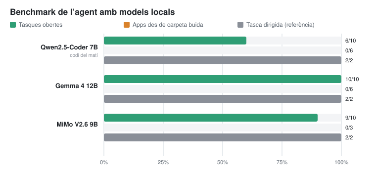

# Agentic Coder MVP (macOS Apple Silicon, 16 GB RAM)


Prototip local-first d'escriptori amb Electron + TypeScript. El model s'executa dins de l'app amb MLX d'Apple, en un procés local aïllat de la interfície: Qwen2.5-Coder 7B per defecte, i Gemma 4 12B o MiMo V2.6 9B si se'n descarreguen els pesos, seleccionables a la barra de dalt. Només hi ha un model a la GPU alhora. No utilitza Ollama, llama.cpp ni un servidor LLM separat.


## Finestres
Cada finestra és una funcionalitat; s’obren i es tanquen des de les icones de la barra de l’esquerra.

- **Xat** amb l’agent: demanes canvis o preguntes sobre el projecte, i el model llegeix, escriu, executa i comprova.
- **Fitxers i converses** del projecte obert.
- **Editor** (Monaco) amb **Historial local** de cada fitxer, en una finestra flotant com les de macOS.
- **Navegador web** per veure la pàgina del projecte, i **Consola** amb el que hi escriu.
- **Avaluació**: el benchmark de l’agent amb el model triat, la comparativa entre models i què ha fet el model a cada tasca.
- **Git** de només lectura: branca, estat, diffs i historial.
- **Aprenentatge local**: els casos verificats i l’entrenament d’un model propi.
- **Terminal** a la carpeta del projecte.

En tancar i tornar a obrir, l’app queda com la vas deixar: la mida i la posició de la finestra (també si era a pantalla completa o maximitzada), els panells oberts, les seccions obertes de l’Avaluació i l’Historial local (on era, la mida i si estava minimitzat o gran). Per a cada projecte, recorda també la pàgina del navegador i el fitxer de l’editor; si el fitxer ja no hi és, l’editor queda tancat.

## Què inclou
- Aplicació d'escriptori Electron.
- Selecció d'una carpeta de projecte i exploració de fitxers.
- Inferència local amb MLX d’Apple. Els models que l’app coneix són a [`src/electron/mlx-models.cjs`](src/electron/mlx-models.cjs); el selector només mostra els que tenen els pesos al Mac, i també hi apareixen les versions pròpies entrenades amb l’app. El treballador MLX tradueix el format de crides a eines de cada família (Qwen 2.5, Qwen 3.5, Gemma 4) al de l’agent i desactiva el raonament ocult. Transformers.js es manté només per als embeddings de la cerca semàntica.
- Un sol model a la GPU en tot el Mac: cada procés que en carrega un (el xat, una avaluació, un entrenament, una prova des del terminal) agafa un pany comú (`~/.agentic-coder/mlx.lock`); el segon espera fins a 30 s i, si no s’allibera, ho diu en lloc de carregar-se. Dos models alhora en 16 GB van fer reiniciar el Mac amb un error del controlador de la GPU.
- Panell **Avaluació** (icona de gràfic a la barra de baix): passa el benchmark de l’agent amb el model triat, mostra el progrés, la comparativa entre models, què ha fet el model torn a torn a cada tasca, i obre com a projecte la carpeta on ha treballat.
- Panell **Aprenentatge local**: compta els casos verificats i, a partir de 30, entrena una versió pròpia (vegeu [Aprenentatge](#aprenentatge-el-vostre-model)).
- Context limitat del projecte que prioritza `AGENTS.md`, README, manifestos de dependències i fitxers d’entrada; converses persistides localment, que es poden eliminar d’una en una des de la llista.
- Cerca semàntica local i opcionalment carregada per recuperar casos verificats del mateix projecte amb un model multilingüe independent de Qwen; si no està disponible, es manté la cerca per paraules.
- La lectura de context respecta regles habituals de `.gitignore` a l’arrel i als subdirectoris, inclosos comodins i negacions senzilles; també manté exclusions fixes per a carpetes generades i fitxers ocults.
- Execució explícita de `npm test` al projecte seleccionat.
- Execució de scripts existents del projecte a petició de l’agent, sense confirmació, i instal·lació de paquets npm amb confirmació.
- Panell Git de només lectura amb branca, estat, diff preparat i diff local; només mostra el repositori si coincideix amb la carpeta de projecte seleccionada.
- Límits bàsics de ruta i mida per a lectura/escriptura a través de l'IPC.
- Historial local per fitxer a partir de les còpies de cada canvi: comparació costat a costat amb Monaco i restauració confirmada, que desa abans la versió actual. Les converses i els fitxers s’organitzen en seccions plegables amb Accordion i TreeView de Chakra UI.
- Eliminació de fitxers a petició de l’agent sense confirmació, però amb còpia de recuperació verificada fora del projecte i comprovació que el fitxer no hagi canviat; el panell de còpies permet restaurar-los sense sobreescriure fitxers existents.
- Contracte `InferenceEngine` tipat: el motor MLX (per defecte) i el de Transformers.js estan aïllats de l'orquestrador.
- Registre local de casos verificats, amb procedència i confirmació de l'usuari, que guarda tota la seqüència d’eines de la conversa.

La decisió del motor, els models provats i l'aprenentatge estan documentats a [`docs/engine-and-learning.md`](docs/engine-and-learning.md).

## Requisits
- macOS amb Apple Silicon.
- Node.js 20 LTS o posterior (recomanat).
- Python 3.12 amb MLX en un entorn propi a `models/.mlx-venv` (`python3 -m venv models/.mlx-venv && models/.mlx-venv/bin/pip install mlx-lm`).
- Connexió a internet per instal·lar dependències i descarregar els pesos una vegada. El Qwen 7B va a `models/.hf` (memòria cau de Hugging Face); els altres models, a `models/mlx/<carpeta>`:

```bash
models/.mlx-venv/bin/hf download lmstudio-community/gemma-4-12B-it-MLX-4bit --local-dir models/mlx/gemma-4-12b-it-4bit
models/.mlx-venv/bin/hf download mlx-community/MiMo-V2.6-Distill-Qwen-9B-OptiQ-4bit --local-dir models/mlx/mimo-v2.6-distill-qwen-9b-4bit
```

Després, tot s’executa localment.

## Inici

```bash
npm install
npm run check
npm start
```

La primera petició al model tarda una mica perquè el carrega a la memòria (uns segons per al 7B; més per als models grans). La primera cerca de casos verificats pot descarregar el model d’embeddings. Cap petició s’envia a una API remota.

Per executar l’avaluació sintètica de recuperació semàntica sense llegir dades personals, fes servir `npm run evaluate:memory`. Compara `Recall@3` i `MRR@3` amb la cerca per paraules; és una prova petita, no una validació suficient per entrenar ni substituir cap model.

Per mesurar l’agent sencer amb el model real, fes servir `npm run evaluate:agent` (Qwen 7B per defecte; `-- --model gemma` o `-- --model mimo` per als altres), o el panell **Avaluació** de l’app, que fa el mateix. És un conjunt fix de tasques, cadascuna en una carpeta temporal nova:

- **Tasques obertes de codi:** corregir una prova que falla sense tocar la prova, afegir una funció que una prova ja espera, crear una pàgina, fer un comptador de clics que funcioni, i respondre una pregunta sense tocar res.
- **Apps des d’una carpeta buida**, amb la petició tal com la diria una persona («Munta’m una interfície amb Chakra UI» i dues variants obertes). Poden instal·lar paquets amb xarxa. Passen si `npm run build` passa, la pàgina compilada carrega sense errors de consola i mostra contingut, i, si demanen Chakra UI, si és la v3 sense API que la v3 va treure.
- **Tasca dirigida** (de referència, fora del total obert): la mateixa correcció dient exactament què canviar.

El resultat es decideix amb comprovacions objectives sobre la carpeta; no hi ha cap model fent de jutge. L’informe JSON (amb el que ha vist i respost el model a cada torn) es desa a `logs/benchmarks/`. Opcions: `--task <id>` (o diversos separats per comes), `--repeat <n>`, `--keep` per conservar les carpetes i `--list` per veure les tasques. Les tasques són a [`scripts/agent-benchmark/`](scripts/agent-benchmark/). `node scripts/benchmark-chart.cjs <informes…>` dibuixa `docs/benchmark.svg` i escriu la taula de resultats.

### App instal·lable per a macOS (`.dmg`)

```bash
npm run dist:mac
```

Genera `dist/Agentic Coder-0.1.0-arm64.dmg` (Apple Silicon) amb electron-builder. Cal executar-ho al Mac. El paquet no està signat ni notaritzat: la primera vegada macOS dirà que no pot verificar el desenvolupador; obre’l amb clic dret › Obre, o a Configuració del Sistema › Privadesa i seguretat › Obre igualment.

Els pesos dels models no van dins del `.dmg` (en fan uns quants GB). L’app instal·lada els busca a `~/Library/Application Support/Agentic Coder/models`, amb la mateixa estructura que la carpeta `models/` del repositori. La manera més senzilla és enllaçar-hi la carpeta que ja tens:

```bash
mkdir -p ~/Library/Application\ Support/Agentic\ Coder
ln -s ~/Desktop/agentic-coder-mvp/models ~/Library/Application\ Support/Agentic\ Coder/models
```

També es pot indicar una altra carpeta amb la variable `AGENT_MODELS_DIR`. Altres diferències de l’app instal·lada:

- Les dades (converses, historial de fitxers, casos verificats, registre de torns) es desen a `~/Library/Application Support/Agentic Coder/`, no a les de la versió que s’executa des del repositori: les converses d’una no apareixen a l’altra.
- El primer cop obre una carpeta buida pròpia (`projecte-de-prova` dins d’aquella carpeta de dades), mai la carpeta personal.
- El model s’executa en un procés Node.js a part. Si no troba Node al `PATH` ni a `/opt/homebrew/bin` o `/usr/local/bin`, fa servir el Node que porta Electron.
- No inclou actualitzacions automàtiques.

### Què surt de la màquina

- La descàrrega inicial dels models des de Hugging Face.
- L’eina de cerca web està desactivada per defecte (tornava poca cosa útil); amb `AGENT_WEB_SEARCH=1` es torna a activar, i llavors la consulta (no el codi ni la conversa) s’envia a DuckDuckGo.
- L’eina `run_npx`: executa l’eina de línia d’ordres d’un paquet npm (`npx <paquet> <arguments>`), com demanen moltes guies d’instal·lació. Baixa i executa codi, de manera que demana permís amb la mateixa regla que instal·lar un paquet.
- L’eina de lectura de pàgines: quan l’agent vol llegir un resultat o una documentació, l’app obre aquella adreça pública en una finestra amagada del navegador que ja porta Electron, deixa que la pàgina s’executi i n’agafa el text visible (si no pot, la baixa directament). Només surt l’adreça; no llegeix adreces locals ni de la xarxa interna.
- Les instal·lacions de paquets npm que confirmis.

Tota la resta (inferència, converses, historial de fitxers, casos verificats) es queda en local.

## Limitacions conscients del MVP
- El 7B en 4 bits ocupa 4,28 GB; en un Mac de 16 GB, amb converses llargues, MLX pot quedar-se sense memòria de GPU (`kIOGPUCommandBufferCallbackErrorOutOfMemory`). Els models de 3B o menys rebrien un mode reduït (instruccions curtes, poques eines, uns 4 KB del projecte); es pot forçar amb `AGENT_COMPACT=1` o `AGENT_COMPACT=0`.
- La interfície permet obrir fitxers des d’un arbre de carpetes, editar-los i revisar el contingut abans de desar. L’editor no desa res sol: es desa amb el botó petit de desar o amb ⌘S, i cada desat crea una versió a l’historial local de l’aplicació; el panell compara versions i permet restaurar-les amb confirmació. Això val per a l’edició manual. Quan l’agent fa servir les seves eines, els canvis de fitxers s’apliquen directament i en queda una còpia recuperable.
- L'execució de tests és una acció explícita de l'usuari.
- El registre JSONL conserva els intercanvis complets de l’agent; les converses de la interfície es desen separadament a SQLite. Els casos verificats es poden cercar amb embeddings locals; això no entrena ni modifica el model generatiu.
- L'entrenament nocturn no està implementat encara. La preparació local de candidatures de dades existeix, però encara cal revisar-ne qualitat, ampliar l’avaluació independent, trobar un mètode d’entrenament compatible, gestionar versions del model i rollback. No s'ha de modificar el model actiu sense superar benchmarks.

## Seguretat
Utilitza’l només amb carpetes de prova o projectes de confiança. L’agent actua sol dins la carpeta seleccionada:

- **Sense confirmació:** llegir, crear, modificar i eliminar fitxers de la carpeta (cada canvi deixa una còpia recuperable), executar `npm test` i altres scripts de `package.json`, iniciar el projecte i crear commits de Git.
- **Amb confirmació (si no ho canvies):** instal·lar un paquet npm. A la barra d’estat hi ha l’interruptor «Permisos: pregunta / automàtic»; en automàtic l’agent instal·la paquets sense preguntar, i la tria es recorda entre sessions. La finestra mostra el paquet, l’ordre i la carpeta, i només surt la primera vegada per projecte i sessió: un cop acceptada, les instal·lacions següents en aquell projecte no pregunten fins que es tanca l’app. És l’única acció que baixa codi d’internet triat pel model.

Els fitxers queden limitats a la carpeta, però els scripts no: un script de `package.json` s’executa amb els permisos del teu usuari i pot fer qualsevol cosa a l’ordinador, i l’agent pot escriure aquest fitxer. Electron no és un entorn aïllat. No posis secrets al prompt ni als fitxers indexats.

Per a tasques de codi, l’agent ha d’inspeccionar instruccions i scripts, preparar un pla, implementar, executar comprovacions adequades i resumir els fitxers, resultats i limitacions. La inspecció de pàgines la fa la mateixa app amb el navegador que ja porta Electron: obre l’adreça local en una finestra amagada, hi fa els clics i omple els camps que calgui, i en llegeix el text i els errors de consola. No cal instal·lar Playwright ni res més al projecte. Només es pot afirmar que una pàgina funciona quan l’eina l’hagi mirada i n’hagi retornat els resultats.

### Instruccions per projecte: `AGENTS.md`

Si a l’arrel del projecte hi ha un fitxer `AGENTS.md`, l’agent el rep com a instruccions de l’usuari i les segueix (gestor de paquets, convencions, carpetes que no ha de tocar…). La resta de fitxers continuen sent dades. Compte en obrir projectes d’altres: un `AGENTS.md` que no has escrit tu també serà obeït, sempre dins la carpeta seleccionada. Hi ha un exemple a [`docs/AGENTS.exemple.md`](docs/AGENTS.exemple.md).

### Perfils per projecte: `SKILLS.md`

Al costat d’`AGENTS.md` hi pot haver un `SKILLS.md`: el teu catàleg de perfils i maneres de treballar. Cada títol `## Nom` és un perfil i el text de sota són les seves instruccions; una primera línia opcional `Paraules: a, b, c` hi afegeix paraules que l’activen. L’agent sempre veu la llista de noms, i el text d’un perfil només s’afegeix quan el missatge el demana: pel nom (`@qa-engineer` o «com a QA Engineer»), per una de les seves paraules o per una paraula llarga del títol. Com a màxim dos perfils per missatge. Afegir, treure o canviar perfils és editar el fitxer; no cal tocar l’app. Hi ha un exemple a [`docs/SKILLS.exemple.md`](docs/SKILLS.exemple.md).

### Servidors MCP per projecte: `mcp.json`

Un servidor MCP és un programa que dona a l’agent coneixement o eines que no té: per exemple, la documentació actual d’una llibreria. Per connectar-ne un, posa un `mcp.json` a l’arrel del projecte amb la mateixa forma que fan servir altres eines:

```json
{ "mcpServers": { "chakra": { "command": "npx", "args": ["-y", "@chakra-ui/react-mcp"] } } }
```

En començar una tasca, l’app inicia els servidors declarats (transport stdio), en llista les eines i les passa al model, que les pot cridar abans d’escriure codi. Iniciar un servidor és executar un programa que pot baixar codi d’internet: l’app demana permís el primer cop, tret que els permisos estiguin en automàtic. Els servidors s’aturen en tancar l’app. Només amb el model gran. Exemple a [`docs/mcp.exemple.json`](docs/mcp.exemple.json).

A part d’això, amb el model gran sempre hi ha un segon perfil fix, el revisor: quan el programador acaba, el mateix model rellegeix els fitxers escrits amb unes altres instruccions i el pot fer tornar una vegada.

## Benchmark

Resultats amb el conjunt fix de tasques (`npm run evaluate:agent` o el panell Avaluació), al MacBook Pro M2 Pro de 16 GB, 13 de novembre de 2026. Cada model suma les passades del dia (Qwen i Gemma, dues rondes; MiMo, una ronda de les obertes més la passada completa de 9 tasques des de l’app).



| Model | Tasques obertes | Tasca dirigida | Apps des de carpeta buida | Temps mitjà per tasca |
| --- | --- | --- | --- | --- |
| Gemma 4 12B | **10/10** | 2/2 | 0/6 | 441 s |
| MiMo V2.6 9B | 9/10 | 2/2 | 0/3 | 261 s |
| Qwen2.5-Coder 7B (codi del matí) | 6/10 | 2/2 | 0/6 | 197 s |

- **Gemma 4 12B** fa totes les tasques obertes, també la correcció sense indicacions, però és el més lent. Apps: una amb l’API de Chakra v2 (`ChakraProvider` sense `value`) i el build sense Vite; una sense `package.json` vàlid; quatre per temps esgotat (1.200 s), perquè intenta escriure tota l’app en una sola resposta.
- **MiMo V2.6 9B** només falla la correcció sense indicacions, per temps (600 s), i tocant la prova protegida. Apps: cap arriba a tenir un `package.json`. En dues escriu les crides de diversos fitxers en una sola resposta, algunes buides, i la del `package.json` queda tallada i no s’executa; a la tercera, en 30 torns no fa cap crida vàlida. (Des de 4534440 l’agent executa la primera crida vàlida d’una resposta amb diverses; aquesta passada és d’abans.)
- **Qwen2.5-Coder 7B** (amb el codi del matí, abans dels arreglos de la tarda): apps sempre amb Chakra UI v2 i la seva API, i el build no passa (falta Vite o l’script `build`).

Cap model fa encara una app des d’una carpeta buida sense ajuda. Per això l’app permet ensenyar-l’hi (secció següent).

## Aprenentatge: el vostre model

El model aprèn del que li ensenyeu fent-lo servir, no de textos escrits per ningú:

1. Demaneu-li una feina al xat (millor en una carpeta buida). Si sol no se’n surt, guieu-lo amb frases curtes («instal·la Chakra UI», «el build falla, mira l’error»).
2. Quan el resultat funciona, **Desa com a cas verificat**: indiqueu què heu comprovat i la **petició general** (el que voldríeu demanar d’una sola vegada). Es desa tota la conversa amb cada eina que el model va cridar, amb els arguments i el resultat que va veure.
3. Amb **30 casos** verificats, al panell **Aprenentatge local** s’activa **Entrena**. Amb el nom que trieu, en segon pla i cancel·lable: es preparen entrenament/validació/prova, s’entrena un adaptador LoRA (`mlx_lm lora`) sobre el model triat, es compara amb el model base (pèrdua al conjunt de prova i benchmark) i **només si millora i el benchmark no empitjora** es fusiona en una versió nova, `models/mlx/<nom>-vN` amb `agentic-model.json` (model base, dades i el seu hash, data i mètriques). Apareix al selector de models; les versions anteriors es queden i s’hi pot tornar. Els pesos base no es modifiquen mai. Si no millora, no es publica res i el panell diu per què.

Els exemples d’entrenament comencen per la petició general i segueixen amb els passos que van funcionar: els missatges de guia no hi són, perquè el model aprengui a fer-ho sol a partir de la petició oberta. Detalls a [`docs/engine-and-learning.md`](docs/engine-and-learning.md).

## Instruccions del model (carpeta `prompts/`)

Tot el text que l’agent envia al model és fora del codi, a [`prompts/`](prompts/): un fitxer Markdown per bloc. Hi ha les instruccions de sistema, el context de cada petició, les descripcions de les eines, els recordatoris que afegeix durant una tasca, l’enquadrament dels resultats de les eines i les preguntes del revisor. El codi només hi omple les parts variables, escrites `{{així}}` (per exemple `{{folder}}`, `{{files}}`, `{{projectInstructions}}`).

- Es poden editar, retallar o buidar. Cada fitxer es llegeix cada vegada que es fa servir, així que un canvi s’aplica a la petició següent sense reiniciar l’app.
- Un fitxer buit o que no hi és vol dir «cap text»: l’agent continua funcionant sense aquell text, i el codi no el torna a posar. L’ordre dels passos (per exemple, demanar un pla abans del primer canvi) és lògica del codi i no depèn de cap text.
- Les instruccions pròpies d’un projecte continuen a `AGENTS.md` i `SKILLS.md` de l’arrel de cada projecte; `prompts/` és el comportament general de l’agent.
- Amb `AGENT_PROMPTS_DIR=/una/carpeta` l’app llegeix els textos d’una altra carpeta. L’app instal·lada porta una còpia de `prompts/` dins del paquet.
- Els missatges que es mostren a la interfície no hi són: no els llegeix el model.

Quan es van treure del codi (13-11-2026) es va comprovar que el model rebia exactament els mateixos textos que abans en onze escenaris simulats (instruccions, eines, recordatoris, resultats, revisor, agents delegats).

| Bloc | Fitxers |
| --- | --- |
| Instruccions de sistema | `system`, `system-compact`, `system-delegation`, `system-delegated-agent`, `system-web-search`, `system-web-pages`, `system-tools-delegation`, `system-tools-no-delegation` |
| Context que acompanya cada petició | `context-agents-md`, `context-compact-contents`, `context-folder-empty`, `context-folder-no-entry`, `context-folder-project`, `context-mcp`, `context-skills-active`, `context-skills-list`, `context-web-pages` |
| Descripcions de les eines | `tools` |
| Recordatoris durant la tasca | `assistant-plan-brief`, `assistant-plan-published`, `nudge-after-list-files`, `nudge-app-entry-missing`, `nudge-app-no-files`, `nudge-carry-out-plan`, `nudge-check-failed-repeat`, `nudge-context-limit`, `nudge-execute-plan`, `nudge-invalid-call`, `nudge-no-change`, `nudge-no-commit`, `nudge-no-questions`, `nudge-no-web-search`, `nudge-not-validated`, `nudge-plan-visible`, `nudge-repeated-call`, `nudge-write-plan` |
| Resultats d’eines i comprovacions | `check-retry-incomplete`, `check-retry-passed`, `check-retry-result`, `check-retry-still-failing`, `tool-result`, `tool-result-check-failed`, `tool-result-continue`, `tool-result-page-problem` |
| Pistes quan la pàgina no funciona | `page-hint-changed-file`, `page-hint-console-error`, `page-hint-file`, `page-hint-missing-export`, `page-hint-missing-import`, `page-hint-no-error`, `page-hint-not-defined`, `page-hint-provider` |
| Revisor | `review-fix-recheck-page`, `review-fixes`, `review-page-not-opened`, `review-page-seen`, `review-request`, `review-system` |
| Agents delegats | `delegated-task` |

## Model i llicència
El codi d’aquest repositori es publica sota la llicència MIT (vegeu [`LICENSE`](LICENSE)). Els models tenen la seva pròpia llicència:

Els models generatius són `mlx-community/Qwen2.5-Coder-7B-Instruct-4bit` (Apache-2.0), `lmstudio-community/gemma-4-12B-it-MLX-4bit` (Gemma 4, Apache-2.0) i `mlx-community/MiMo-V2.6-Distill-Qwen-9B-OptiQ-4bit` (MiMo V2.6, MIT); consulta’n el model card. La cerca semàntica opcional utilitza `Xenova/paraphrase-multilingual-MiniLM-L12-v2`, també sota Apache-2.0. Consulta els [model cards de Qwen](https://huggingface.co/mlx-community/Qwen2.5-Coder-7B-Instruct-4bit) i [MiniLM multilingüe](https://huggingface.co/Xenova/paraphrase-multilingual-MiniLM-L12-v2) abans de redistribuir pesos o crear un producte.


## Fases del projecte

- [Primera fase: Agentic Desktop IDE](docs/primera-fase-projecte.md)
- [Segona fase: aprenentatge autònom i evolució del model](docs/segona-fase-projecte.md)

### Estat verificat

| Fase | Estat actual |
| --- | --- |
| Motor local | MLX carrega Qwen2.5-Coder-7B (4 bits) des de `models/.hf` en un procés local. Històric: Transformers.js havia carregat Qwen2.5-Coder-1.5B, ja retirat (13-11-2026: 3/6 al benchmark, igual que el 7B, però fallava en tasques obertes). La prova amb la xarxa físicament desactivada i l’acceleració Metal encara estan pendents. |
| Orquestrador | Bucle local d’eines limitat, validació d’arguments, restricció a la carpeta seleccionada, creació segura de subcarpetes i còpia recuperable de cada fitxer modificat o eliminat; només la instal·lació de paquets demana confirmació. Detecta també peticions catalanes com «fes una aplicació nova» com a tasques d’implementació; una explicació sense cap fitxer escrit no es presenta com a feina acabada. Abans de començar, les instruccions demanen al model revisar les eines disponibles i triar-ne una. En una conversa nova, Qwen 7B va crear un fitxer `index.html` real; en una tasca de portfoli va crear `src/index.html` i `src/styles.css`, però no va completar l’entrada funcional a l’arrel. Per tant, pot executar eines en tasques simples, però encara falla en alguns projectes oberts. La generació es pot aturar tancant el procés aïllat del model, que es torna a carregar en la petició següent; les accions confirmades en curs no s’interrompen. No hi ha una eina de shell lliure per al model. |
| Navegador i edició | Les peticions explícites d’arrencar una app local i d’inspeccionar una URL localhost criden les eines directament. La inspecció pot comprovar elements accessibles, clicar, omplir camps i verificar text amb un màxim de 12 accions; no s’accepten selectors arbitraris ni JavaScript del model. La inspecció la fa el navegador que ja porta Electron, sense instal·lar res al projecte; amb la versió anterior basada en Playwright, Agentic Coder va iniciar Notes al webview i va obtenir HTTP 200, títol `Notes` i cap error de consola, pàgina o xarxa. En una tasca real amb Qwen local, una instrucció llarga no va produir cap canvi; una instrucció directa i acotada sí que va corregir `src/math.cjs` i `npm test` va passar (1/1). El cicle d’interacció del navegador amb l’orquestrador i la fiabilitat general del model encara s’han de validar junts. |
| Interfície | React, TypeScript, Chakra UI, Monaco per editar codi, xterm.js per a la terminal, xat amb historial local, panells separables, navegador integrat i panell Git de només lectura. `git-interface` aporta les branques locals i els remots; les operacions de canvi continuen protegides pels controls locals. La distribució instal·lable encara no està feta. |
| Memòria i aprenentatge | Converses guardades a SQLite local, associades al projecte quan se selecciona i restaurades amb la carpeta corresponent; migració des de `localStorage`. Els casos verificats es desen amb tota la seqüència d’eines i se’n recuperen fins a tres del mateix projecte amb un model d’embeddings multilingüe local. L’entrenament LoRA → avaluació → fusió en una versió pròpia està fet i provat amb un executor simulat; encara no s’ha entrenat cap versió amb casos reals. |
| Distribució | `npm run dist:mac` genera un `.dmg` sense signar per a Apple Silicon; els models es llegeixen de la carpeta de dades de l’app. Falten signatura, notarització i actualitzacions automàtiques. |
| Models | Qwen 7B, Gemma 4 12B i MiMo 9B carreguen en un Mac de 16 GB (Gemma, fins a ~9,6 GB). Comparativa amb el benchmark: vegeu [Benchmark](#benchmark). |

El registre detallat de la decisió del motor i de les limitacions és a [`docs/engine-and-learning.md`](docs/engine-and-learning.md).
