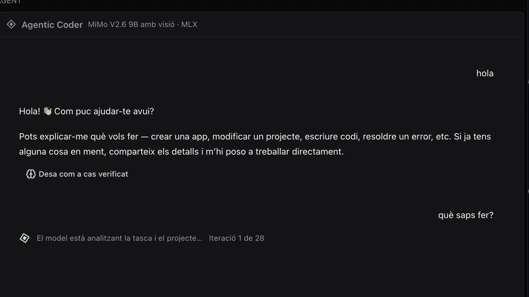

# Una eina per entrenar el teu propi model llm. Com més potent la teva màquina, més gran el model

[Mira el vídeo sencer (1 min) a la web.](https://celtico.github.io/agentic-coder-mvp/#video)

**Agentic Coder** és el teu propi model de programació. Funciona al teu ordinador, aprèn de tu i creix
amb la teva màquina. És privat: no fa servir el núvol.

1. **Guia** l'agent mentre programa.
2. **Desa** els casos que surten bé.
3. **Entrena** una versió pròpia amb LoRA.
4. **Compara-la** amb l'original i queda't la millor.

## Descàrrega

Les versions són a [Releases](https://github.com/Celtico/agentic-coder-mvp/releases). Els models es
baixen des de l'app.

- **Mac (Apple Silicon):** `.dmg`. Ja s'ha provat.
- **Linux (GPU NVIDIA):** `.AppImage` o `.deb`. Encara no s'ha provat.
- **Windows (GPU NVIDIA):** `.exe`. Encara no s'ha provat.

**Desenvolupament:** `npm start`. Les guies són a [docs/guia.md](docs/guia.md), [Linux](docs/linux.md),
[Windows](docs/windows.md) i [com publicar una versió](docs/publicar.md).
