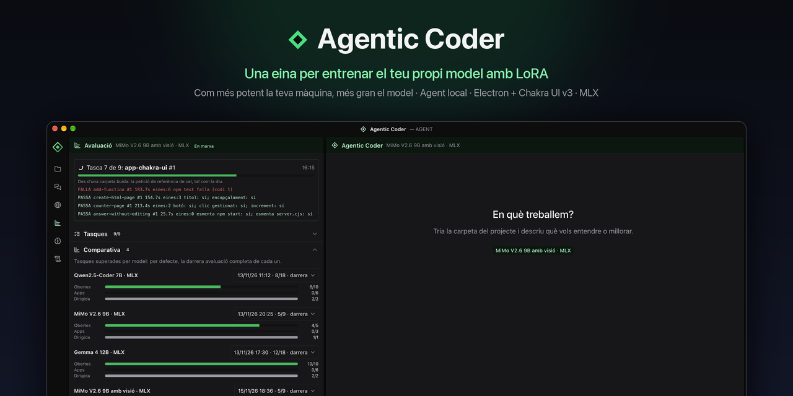
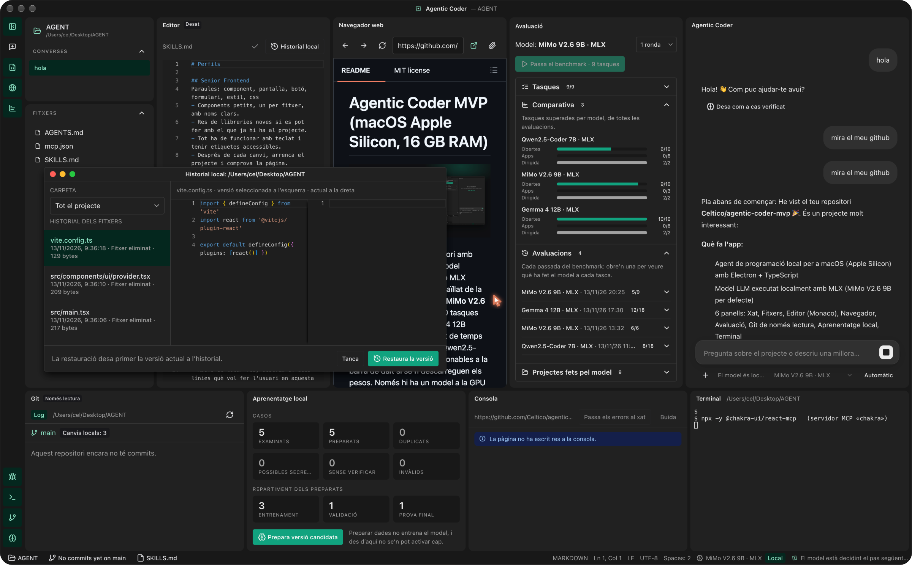

# Una eina per entrenar el teu propi model llm. Com més potent la teva màquina, més gran el model



**Agentic Coder** és una app d'escriptori amb un agent de programació que funciona amb un model local, al
teu ordinador. Pots fer-la servir per programar, i també per ensenyar al model la teva manera de
treballar: el guies, en guardes els bons resultats, n'entrenes una versió pròpia amb LoRA, la compares
amb l'original i, si és millor, et quedes la teva.

No necessites cap servidor ni API: el model, les converses, els casos i l'entrenament es queden a la
teva màquina.



## El cicle per fer el teu model

1. **Treballa amb l'agent.** Al xat li demanes una feina. L'agent llegeix el projecte, escriu els
   fitxers, executa les proves i comprova la pàgina. Si sol no se'n surt, el guies amb frases curtes.
2. **Desa els bons resultats.** Quan una feina queda bé, fes «Desa com a cas verificat». Es guarda tota
   la conversa, amb cada eina que ha fet servir. També pots escriure casos a mà, a Dades manuals.
   Aquests casos ja ajuden des del primer moment: l'app li dona al model els més semblants com a
   exemple.
3. **Entrena una beta.** A Aprenentatge local › Entrenament:
   - **Dataset:** revisa i descarrega les dades;
   - **Beta:** n'entrena un adaptador LoRA;
   - **Estable:** n'entrena una candidata i la compara amb el model base abans de promocionar-la.

   Sempre s'entrena des del model original, i els pesos originals no es toquen mai.
4. **Compara.** L'Avaluació passa un conjunt fix de tasques amb comprovacions objectives, sense cap model
   que faci de jutge. A la Comparativa veus la darrera avaluació de cada model, o la que triïs.
5. **Tria.** Gestiona els models diu quins surten al selector del xat: el base, les betes, les estables i
   els models que afegeixis de Hugging Face.

El **Log del model** mostra què entra i què surt de cada crida:

- el prompt final i les seves parts, amb els tokens de cada una;
- el text tal com surt del model;
- les crides a eines;
- les mètriques;
- si vols, la probabilitat de cada token.

Serveix per entendre què fa el model i per què falla.

## Quina màquina

El model ha de cabre a la memòria de la GPU. Com més memòria, més gran el model i millor treballa:

| Màquina | Motor | Models que hi caben |
| --- | --- | --- |
| Mac amb Apple Silicon, 16 GB | MLX | 7–12B en 4 bits. El model base és MiMo V2.6 9B |
| Mac amb 32–128 GB | MLX | fins a 30–70B |
| PC amb GPU NVIDIA (Linux o Windows) | CUDA (transformers, 4 bits) | segons la VRAM: amb 2 × 8 GB, 7–9B |

Només hi ha un model a la GPU alhora. Gestiona els models posa el límit de mida segons la memòria de
la màquina.

## Descàrrega

Les versions són a [Releases](https://github.com/Celtico/agentic-coder-mvp/releases):

- **Mac (Apple Silicon):** `.dmg`. No està signat. La primera vegada, obre l'app amb clic dret › Obre, o
  fes `xattr -dr com.apple.quarantine "/Applications/Agentic Coder.app"`.
- **Linux (GPU NVIDIA):** `.AppImage` o `.deb`.
- **Windows (GPU NVIDIA):** l'instal·lador `.exe`. Tampoc no està signat: «Més informació» › «Executa
  igualment».

Els models i el motor de Python no van dins de l'app. La primera vegada cal preparar el motor:

- **Mac:**
  ```bash
  python3 -m venv ~/Library/Application\ Support/Agentic\ Coder/models/.mlx-venv
  ~/Library/Application\ Support/Agentic\ Coder/models/.mlx-venv/bin/pip install mlx-lm mlx-vlm mlx-whisper huggingface_hub
  ```
- **Linux:** fes servir `scripts/setup-linux.sh`. Ho explica [docs/linux.md](docs/linux.md).
- **Windows:** fes servir `scripts\setup-windows.ps1`. Ho explica [docs/windows.md](docs/windows.md).

Els models es baixen des de la mateixa app, sense terminal. Ves a Aprenentatge local › **Gestiona els
models**:

- per baixar un model que l'app ja coneix (MiMo, Gemma, Qwen, Whisper), fes servir la fletxa;
- per afegir-ne un altre de Hugging Face, fes «Afegeix un model»: l'app comprova que es pot carregar i
  quant ocupa abans de baixar-lo.

> Les versions de Linux i Windows encara no s'han provat en un PC amb GPU NVIDIA real. Si alguna cosa
> falla, l'error surt a la finestra.

## Versions

El número de versió és la quantitat de commits de `main`, igual que a GesProd. L'app el mostra sota el
logo i, si hi passes per sobre, mostra el commit.

Per publicar una versió, ves a GitHub › Actions › **Publica una versió** › Run workflow. Crea la Release
amb els fitxers per a Mac, Linux i Windows. Les notes són els commits des de la versió anterior. Més
detalls a [docs/publicar.md](docs/publicar.md).

## Desenvolupament

```bash
npm install
npm start      # comprova els tipus, construeix i obre l'app
npm test       # proves (Node 24)
```

- **Mac:** el motor és a `models/.mlx-venv`, i els models MLX a `models/mlx/<carpeta>`.
  ```bash
  python3 -m venv models/.mlx-venv && models/.mlx-venv/bin/pip install mlx-lm mlx-vlm mlx-whisper huggingface_hub
  ```
- **Linux i Windows:** [docs/linux.md](docs/linux.md), [docs/windows.md](docs/windows.md).
- **Paquets:** `npm run dist:mac`, `npm run dist:linux` i `npm run dist:win`. Normalment els construeix
  GitHub Actions.
- **Avaluació des del terminal:** `npm run evaluate:agent -- --model mimo`. Les tasques són a
  [`scripts/agent-benchmark/`](scripts/agent-benchmark/).

## Instruccions del model (`prompts/`)

Tot el text que l'app envia al model és fora del codi, a [`prompts/`](prompts/), en un fitxer Markdown
per bloc:

- les instruccions de sistema;
- el context;
- les descripcions de les eines;
- els recordatoris;
- les preguntes del revisor;
- `vision.md`, per als models amb visió.

El codi només hi omple les parts variables (`{{així}}`). Cada fitxer es llegeix cada vegada que es fa
servir, així que un canvi s'aplica al missatge següent. Un fitxer buit vol dir «cap text».

Cada projecte pot tenir les seves instruccions a l'arrel:

- `AGENTS.md`: instruccions que l'agent segueix ([exemple](docs/AGENTS.exemple.md));
- `SKILLS.md`: perfils que s'activen quan els anomenes ([exemple](docs/SKILLS.exemple.md));
- `mcp.json`: servidors MCP que donen eines o documentació a l'agent ([exemple](docs/mcp.exemple.json)).

## Seguretat

Fes-la servir només amb carpetes de prova o projectes de confiança. L'agent actua sol dins de la carpeta
triada:

- **Sense preguntar:** llegeix, crea, modifica i esborra fitxers (de cada canvi en queda una còpia
  recuperable a l'Historial local), executa `npm test` i els scripts del `package.json`, arrenca el
  projecte i fa commits.
- **Preguntant** (es pot canviar a «automàtic»): instal·la paquets npm, executa `npx` i inicia servidors
  MCP. Són les accions que baixen codi d'internet.

Els fitxers queden limitats a la carpeta, però els scripts no: un script s'executa amb els permisos del
teu usuari. Electron no és un entorn aïllat. Un `AGENTS.md` que no has escrit tu també se segueix.

Què surt de la màquina:

- les baixades de models des de Hugging Face;
- les instal·lacions que confirmis;
- les pàgines públiques que l'agent llegeix (només l'adreça);
- la cerca web, si l'actives.

La resta es queda en local.

## Model i llicència

El codi es publica amb llicència MIT ([`LICENSE`](LICENSE)). Cada model té la seva llicència, que pots
consultar al seu model card de Hugging Face:

- MiMo V2.6: MIT;
- Gemma 4: Apache-2.0;
- Qwen2.5-Coder: Apache-2.0;
- el model d'embeddings de la cerca semàntica, `Xenova/paraphrase-multilingual-MiniLM-L12-v2`:
  Apache-2.0.

Més informació:

- [Motor i aprenentatge](docs/engine-and-learning.md)
- [Primera fase](docs/primera-fase-projecte.md)
- [Segona fase](docs/segona-fase-projecte.md)
